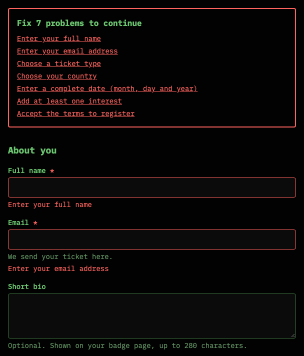
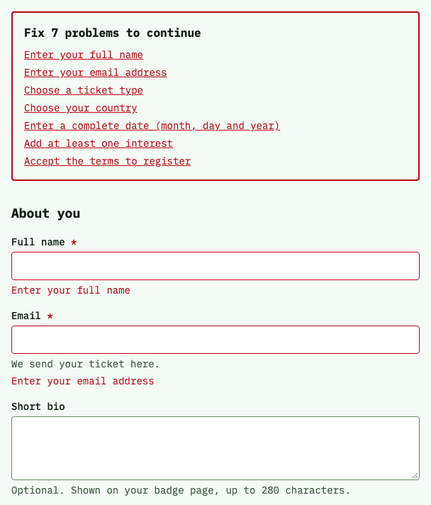

# Console Forms, by Aleix Vidal

**Live Storybook: [design.aleixvidal.dev](https://design.aleixvidal.dev)**

[](https://github.com/thorgotothegym/design-system/actions/workflows/ci.yml)
[](LICENSE)

Eleven React form components with a terminal look. A portfolio project that shows how I structure, document, test and ship a component library: per-component size budgets, axe checks in both themes in CI, and every change through the same gates.

<p>
  
  
</p>

## What is inside

Ten controls and the Field wrapper. Each control has stories for its states (hover, focus, disabled, invalid, and read-only where it applies), tests and its own size budget.

| Component                                                                                | When to use it                                                                            |
| ---------------------------------------------------------------------------------------- | ----------------------------------------------------------------------------------------- |
| [Field](https://design.aleixvidal.dev/?path=/docs/form-components-field--docs)           | Around every control: it wires the label, description, error and required marker for you. |
| [Input](https://design.aleixvidal.dev/?path=/docs/form-components-input--docs)           | A single line of text, with optional prefix, suffix and loading state.                    |
| [Textarea](https://design.aleixvidal.dev/?path=/docs/form-components-textarea--docs)     | Text that can span several lines, optionally growing with its content.                    |
| [Checkbox](https://design.aleixvidal.dev/?path=/docs/form-components-checkbox--docs)     | An independent yes or no that is applied on submit, or a "select all" with a mixed state. |
| [Switch](https://design.aleixvidal.dev/?path=/docs/form-components-switch--docs)         | A setting that takes effect as soon as it is toggled.                                     |
| [RadioGroup](https://design.aleixvidal.dev/?path=/docs/form-components-radiogroup--docs) | Exactly one choice out of two to about five options shown at once.                        |
| [Select](https://design.aleixvidal.dev/?path=/docs/form-components-select--docs)         | One choice from a list too long to show at once.                                          |
| [Slider](https://design.aleixvidal.dev/?path=/docs/form-components-slider--docs)         | A number, or a range, where the approximate position matters.                             |
| [TagInput](https://design.aleixvidal.dev/?path=/docs/form-components-taginput--docs)     | A short list of free-text values, such as interests or keywords.                          |
| [OtpInput](https://design.aleixvidal.dev/?path=/docs/form-components-otpinput--docs)     | A one-time code of fixed length; pasting the whole code fills every box.                  |
| [DatePicker](https://design.aleixvidal.dev/?path=/docs/form-components-datepicker--docs) | A date near today, typed part by part or chosen in a calendar.                            |

Not on npm yet; this is what the API looks like:

```tsx
import { Field, Input } from "@aleixvidal/ui";

export const EmailField = ({ error }: { error?: string }) => (
  <Field required invalid={error !== undefined}>
    <Field.Label>Email</Field.Label>
    <Input type="email" autoComplete="email" />
    <Field.Description>We send your ticket here.</Field.Description>
    <Field.Error>{error}</Field.Error>
  </Field>
);
```

The Storybook also documents the design tokens, in [Foundations](https://design.aleixvidal.dev/?path=/docs/foundations-color--docs) pages generated from the token files, and a [realistic form](https://design.aleixvidal.dev/?path=/docs/patterns-realistic-form--docs) that uses every component with react-hook-form.

Scope: form controls only (no Button, Dialog or Table), for React 19, shipped as ES modules only.

## Design decisions

- **Headless primitives for the hard parts.** Focus management, keyboard navigation and widget roles come from Radix (React Aria for the DatePicker, input-otp for the code field). The components add the styling, the states and the `Field` wiring (ids and the `aria-*` links between label, description, error and control).
- **Semantic tokens in OKLCH, with a contrast gate.** Components use semantic tokens only (`bg.surface`, `text.danger`, `focus.ring`), never raw values; the one exception is CSS system colors under forced colors. The tokens are built with Style Dictionary into CSS variables. A script checks the contrast of every declared color pair in both themes and fails the build on any pair below its minimum.
- **Light and dark from the same tokens.** Every semantic color has a light and a dark value, and the theme switches with one attribute (`data-theme`). Forced colors (Windows contrast themes) are handled with system colors.
- **A size budget per component.** Each component is measured after tree-shaking (React excluded), and CI fails if one grows past its budget. Heavy components have their own entry points: `@aleixvidal/ui/date-picker` (React Aria) and `@aleixvidal/ui/otp-input`, so importing the rest of the library does not pay for them.
- **Little layout shift by design.** An error message has one line reserved, single-line controls have a fixed height per size, and a long Select value is truncated. A message longer than one line, a Textarea that grows and a TagInput that wraps do change the height.

The reasons for each rule are in [AGENTS.md](AGENTS.md) (conventions) and [DESIGN.md](DESIGN.md) (visual direction).

## What CI enforces

Every pull request runs [`ci.yml`](.github/workflows/ci.yml). The `ci-success` job passes only when all of these pass.

| Job        | What it checks                                                                                                                                       |
| ---------- | ---------------------------------------------------------------------------------------------------------------------------------------------------- |
| quality    | ESLint, TypeScript (strict), Prettier, and no leftover scaffold placeholders                                                                         |
| test       | Unit tests with Vitest and Testing Library, including axe on every component, with 80 % line and branch coverage thresholds; the token contrast gate |
| build      | The packages and the static Storybook                                                                                                                |
| a11y       | Every story in Chromium, in both themes: its `play` interaction test and axe, plus checks under emulated forced colors                               |
| size       | The size budget of every component and of the stylesheet                                                                                             |
| lighthouse | Lighthouse on the built Storybook (Performance and Accessibility thresholds)                                                                         |
| consumer   | The packed package installed in a clean Vite app and checked in Chrome                                                                               |
| scaffold   | The repository's component scaffold generates a working component in each of its five variants                                                       |
| changeset  | A changeset for every change to the published package                                                                                                |
| release    | A dry run of the release versioning                                                                                                                  |

Visual regression runs separately on Chromatic ([`chromatic.yml`](.github/workflows/chromatic.yml)): every story in both themes (except a few that depend on today's date or repeat another story's end state), compared with its accepted baseline.

## Accessibility

What is verified:

- axe on every story in a real browser in both themes (CI), and in every component's unit tests;
- keyboard operation and the visible focus indicator of every component, checked with real key events in the audit (one documented deviation: Home and End on a range Slider), and the main flows in the `play` tests in CI;
- forced colors, by emulation in Chromium;
- an audit of the eleven components against WCAG 2.2 AA, with its findings and fixes, in [docs/accessibility.md](docs/accessibility.md).

What is not: **no screen reader pass has been done yet**, and forced colors have not been tested on Windows with a real contrast theme. The manual checklist for both is in the audit. This is not a certification or a conformance claim.

## How it was built

Built with AI coding agents, Claude Code among them, and GitHub Copilot has the same rules. They work under the CI jobs above and the conventions in [AGENTS.md](AGENTS.md), which every agent reads first; each component's pull request records its design decisions and trade-offs. Each change is one pull request. I read every one and merged it myself after CI passed; there is no second reviewer.

## Run it locally

Requires Node 24 (see `.nvmrc`) and pnpm 11.

```sh
pnpm install
pnpm storybook        # Storybook at http://localhost:6006
```

| Command                                            | What it does                                                                                                             |
| -------------------------------------------------- | ------------------------------------------------------------------------------------------------------------------------ |
| `pnpm lint`, `pnpm typecheck`, `pnpm format:check` | Static checks                                                                                                            |
| `pnpm test`                                        | Unit tests with coverage, and the token contrast gate                                                                    |
| `pnpm build`                                       | Builds the packages and the static Storybook                                                                             |
| `pnpm size`                                        | Builds the packages and checks the size budgets                                                                          |
| `pnpm test:storybook`                              | Every story in Chromium, both themes (needs `pnpm --filter @aleixvidal/storybook exec playwright install chromium` once) |
| `pnpm test:consumer`                               | The packed package in a clean app (needs Google Chrome and the network)                                                  |
| `pnpm lighthouse`                                  | Lighthouse on the built Storybook (run `pnpm build` first; needs Google Chrome)                                          |
| `pnpm changeset`                                   | Adds a changeset for a change to the published package                                                                   |

## Repository structure

| Path                                                                                                           | What it is                                                                                           |
| -------------------------------------------------------------------------------------------------------------- | ---------------------------------------------------------------------------------------------------- |
| [`packages/ui`](packages/ui)                                                                                   | The components, `@aleixvidal/ui` ([its README](packages/ui/README.md))                               |
| [`packages/tokens`](packages/tokens)                                                                           | Design tokens: JSON source to CSS variables, TypeScript and a Tailwind theme, plus the contrast gate |
| [`packages/eslint-config`](packages/eslint-config), [`packages/typescript-config`](packages/typescript-config) | Shared ESLint and strict TypeScript configuration                                                    |
| [`apps/storybook`](apps/storybook)                                                                             | The Storybook, deployed to design.aleixvidal.dev                                                     |
| [`scripts`](scripts)                                                                                           | Repository checks run by the root scripts                                                            |
| [`docs`](docs)                                                                                                 | Accessibility audit, deployment and the theme switch                                                 |
| [`.github/workflows`](.github/workflows)                                                                       | CI and Chromatic                                                                                     |
| [`.changeset`](.changeset)                                                                                     | Pending changesets                                                                                   |

## Status

Pre-release: `@aleixvidal/ui` is not published to npm yet. The first release is planned; the work plan and what is left are in [BACKLOG.md](BACKLOG.md).

Issues and feedback are welcome. I am not accepting pull requests yet.

## License

[MIT](LICENSE) © Aleix Vidal
